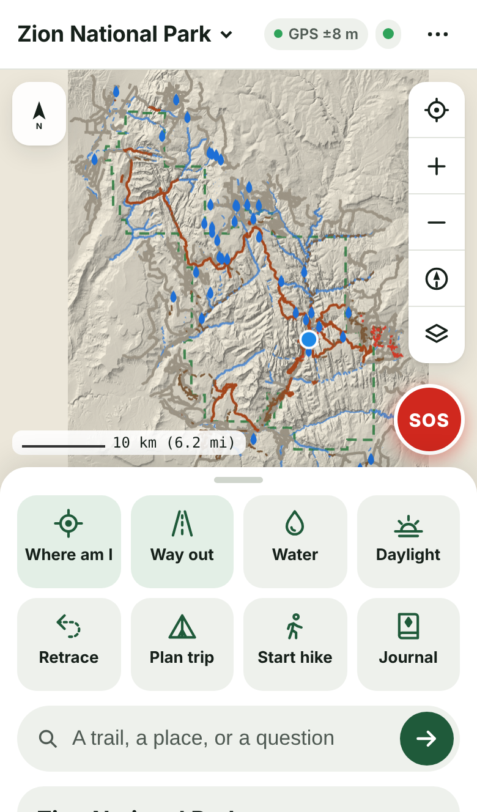
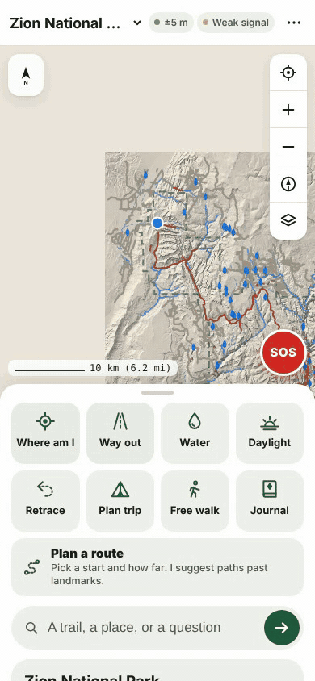

# TrailTruth

**A hiking assistant that is not allowed to make things up.**

TrailTruth is a phone app for hikers. The whole park, meaning trails, water, elevation, roads and landmarks, downloads to your phone, so it works with no signal. It answers the questions people actually ask on a trail ("where am I?", "how do I get out?", "is there water near me?", "when does it get dark?") from official government map data only. When it doesn't know something, it says so.

## Why

Search and rescue teams have been pulling people off mountains after a chatbot or a street-map app gave them a confident, wrong answer. Gemini told three hikers on Mount Shasta to pack far less food and water than they needed. ChatGPT sent two hikers in Poland's Tatra Mountains over a "shortcut" into climbing terrain. Google Maps told three teenagers a trail would take 5 hours and 13 minutes when it takes 8 to 14. The sourced cases are in [RESCUES.md](RESCUES.md).

TrailTruth is built the other way round. The map data answers, and the AI only gets to talk about what the data already proved.

## What it does

- **Where am I.** The trail you're on, which way you're facing, and how far it is to the next junction or road.
- **The way out.** The shortest mapped route back to a road or trailhead, with distance, climb and time.
- **Water.** Mapped springs, streams, lakes and taps near you, and whether a stream runs all year. It can't tell you if water is flowing today, and it says so.
- **Daylight.** Sunset where you are standing, and how much light you have left.
- **Trip planner.** Day-by-day legs, camps, water and exits.
- **Emergency.** One tap shows 911 first (for the US areas the app covers), then your coordinates in three formats including the US National Grid rescuers use, then the nearest places a rescuer can reach.
- **Park passport and achievements.** Walk up to real summits, waterfalls and viewpoints to stamp them. Earn achievements for miles, climb and steps, all measured by the phone.
- **Trail companion.** A small AI model (Gemma 3 1B) that runs on the phone itself. Every name, number and direction it says is checked against the map before you see it. A line it can't back up is cut, and it tells you it left something out. In an emergency it is skipped entirely.

## Where it works

261 downloadable areas in 41 states and 2 territories: national parks, state parks, national forests (big ones split into sections that fit on a phone), wilderness areas, seashores and parkways. **Free Walk** works anywhere, even from your front door: the GPS draws your walk on a USGS topo map, and every saved walk becomes part of your own map layer.

## How it stays honest

1. Every answer is computed from the map data on the phone.
2. A checker reads the final words and rejects any distance, name, direction or claim the data didn't produce.
3. If it doesn't know (weather, closures today, snow, how hard a hike is for you), it says so and shows the facts it does have.
4. With signal, it shows National Weather Service and National Park Service alerts word for word, with their source.

These checks (more than 5,500 tests, each covering many cases, itemized in [CHECKS.md](CHECKS.md)) run on all 261 areas before every release: calls for help asked many different ways at many spots in each park (always answered with 911 first for the US areas the app covers, never dodged), routes checked against the true shortest path, planted lies that the checker has to catch, and questions the data cannot answer.

## The companion, tested blind against Claude

Gemma 3 1B was fine-tuned on answers written by code from the map data (never by another AI), then tested on 80 fresh questions from 14 parks it never trained on. Every model got the same questions, map facts and checks, and two graders (a Claude grader and OpenAI's Codex) graded the answers blind.

**Did it make something up?** (number of answers, out of the same 80 questions per model, n=80)

| | Claude grader | Codex grader |
|---|---|---|
| fine-tuned Gemma 3 1B, round 3 (in the app now) | 3 | 0 |
| fine-tuned Gemma 3 1B, round 4 (after checks built from these same 80 answers, so round 3 is the clean test) | 2 | 2 |
| Claude Haiku | 1 | 5 |
| Claude Sonnet | 3 | 3 |
| Claude Opus | 0 | 4 |
| stock Gemma 3 1B | 47 | 51 |

On 80 questions, gaps of a few answers like these (0 to 5) are within noise, so the claim is parity with Claude, not that it beats Claude. The gap that is real is against stock Gemma.

The 80 hand-graded answers are a sample from a bigger run: 490 answers per model (98 questions, each asked in 5 voices, across the same 14 parks), all scored by the app's own checker. On that run the gap is far outside noise: the checker flagged 13 to 17% of Claude's first drafts and 5% of round 3's (stock Gemma: 47%). My model was trained to pass that checker, so read it as playing on home ground, not as proof it beats Claude.

The fine-tuned model, in the 4-bit build that runs on the phone with no signal, made things up about as rarely as Claude. Claude still packs more into its one line (useful on the line alone: Claude 69 to 72 of 80, ours 54 to 58), but in the app the full map answer always sits under the line. The two graders agreed 94% of the time. The Claude grader was kinder to the Claude models than Codex was (Haiku 1 vs 5, Opus 0 vs 4) and no kinder to mine, so the parity held even under the grader that leaned toward Claude. The full write-up is in the DEV post.

## What's open, and what isn't

This repository is a showcase: the write-up, screenshots, demo GIFs and sources. The app code, data pipeline, test suite and trained model are not published here.

## Data and credits

- Trails, roads and boundaries: USGS National Map, National Park Service, USGS PAD-US
- Elevation: USGS 3D Elevation Program
- Water: USGS National Hydrography Dataset
- Place names: USGS GNIS
- Community paths: © OpenStreetMap contributors (ODbL), via Overture Maps
- Weather and alerts: National Weather Service, National Park Service
- On-phone AI: Google Gemma 3 1B, run in the browser with WebLLM (MLC)
- QR codes: qrcode-generator by Kazuhiko Arase (MIT)

**Not your only navigation.** Carry a paper map and compass, tell someone your plan, and check the park's alerts before you go.

Built with AI coding help (Claude).
